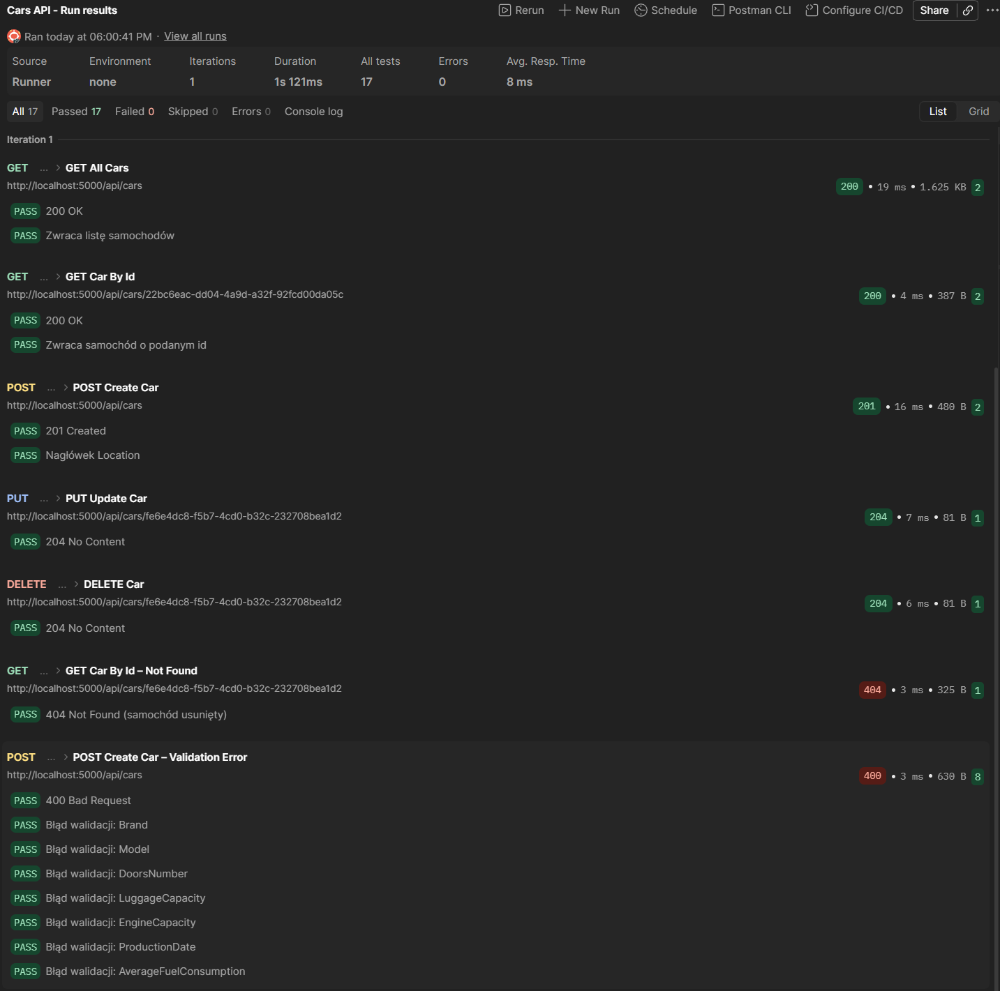

# CarsWebApplication

REST API dla samochodów: ASP.NET Core Web API (.NET 9) + EF Core + SQLite + MediatR + FluentValidation.

- **Lab 1** – szkielet API, EF Core, migracja, Seed, CRUD w kontrolerze.
- **Lab 2** – CRUD przeniesiony do `Cars.Application` (MediatR), walidacja FluentValidation, 400 dla błędnych danych.

## Struktura

| Projekt | Co robi | Zależy od |
|---|---|---|
| `Cars.Domain` | klasa `Car` + enumy `FuelType`, `BodyType` | nic |
| `Cars.Application` | handlery MediatR (`Cars/`), walidatory (`Validators/`), `ValidationBehavior` (`Core/`) | Domain, Infrastructure |
| `Cars.Infrastructure` | `DataContext` (EF Core ↔ SQLite), migracje, `Seed` | Domain |
| `Cars.API` | `CarsController` (tylko `mediator.Send`), middleware błędów walidacji, `Program.cs` | Application, Infrastructure |

Przepływ: żądanie HTTP → `CarsController` → `IMediator.Send(...)` → `ValidationBehavior` (FluentValidation)
→ handler w `Cars.Application/Cars` → `DataContext` → `cars.db`.

Handlery w `Cars.Application/Cars`: `GetCarList`, `Details`, `Create`, `Edit`, `Delete`.

## Uruchomienie

Wymagane .NET 9 SDK.

```bash
dotnet run --project Cars.API
```

Przy starcie aplikacja sama stosuje migracje (`cars.db`) i dodaje dane startowe.
Swagger: http://localhost:5000/swagger

## Endpointy

| Metoda | URL | Kody |
|---|---|---|
| GET | `/api/cars` | 200 |
| GET | `/api/cars/{id}` | 200, 404 |
| POST | `/api/cars` | 201, 400 |
| PUT | `/api/cars/{id}` | 204, 400, 404 |
| DELETE | `/api/cars/{id}` | 204, 404 |

## Walidacja (POST, PUT)

| Pole | Reguła |
|---|---|
| `Brand`, `Model` | niepuste |
| `DoorsNumber` | 2–5 |
| `LuggageCapacity` | ≥ 0 |
| `EngineCapacity` | > 0 |
| `ProductionDate` | nie z przyszłości |
| `AverageFuelConsumption` | > 0 |

Błąd walidacji → `400 Bad Request` z listą błędów per pole (`ValidationProblemDetails`).

## Testy – Postman

Postman → **Import** → `Cars.postman_collection.json` → prawy klik na kolekcji **Cars API** → **Run**.

Folder `Cars`: GET All Cars, GET Car By Id, POST Create Car, PUT Update Car, DELETE Car,
GET Car By Id – Not Found, POST Create Car – Validation Error. Id ustawiają się same, każde żądanie ma testy kodów HTTP.


